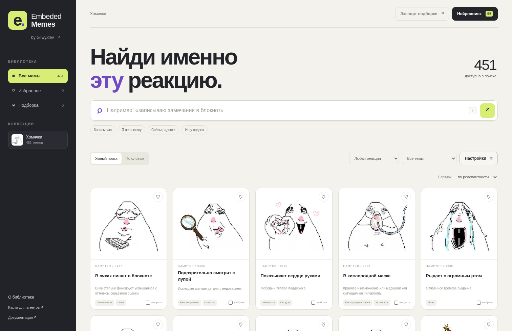

# Embeded Memes by Gliwy.dev

Статическая библиотека мемов с индивидуальными глубокими разборами сложных эмоций, локальным поиском и картой для агентов. Версия 3.0.0; оформление и изображения сохранены.



В коллекции «Хомячки» **374 изображения**, все доступны для поиска; посторонние персонажи и дубли исключены. По запросу владельца одно изображение удалено вместе с исходником, версиями для галереи, записями в каталогах, поисковыми векторами и контактными листами. Остальные изображения и исходные описания сохранены без изменений.

**Оформление:** исходный светлый дизайн, тёмная боковая панель, лаймовый `#D6EE76` и фиолетовый `#7049C7`, двухцветный знак `e.` и отклик карточек при наведении. Палитра и правила: [docs/DESIGN.md](docs/DESIGN.md).

## Открыть

Распакуйте архив. Для обычной галереи предназначен корневой `index.html`: данные подключаются локальными JS-файлами, без `fetch`, сборки, аккаунта и API-ключа. Если браузер ограничивает локальные файлы, запустите сервер из корня проекта:

```bash
python -m http.server 8000 --bind 127.0.0.1
```

Откройте `http://127.0.0.1:8000/`. Для E5 обязательно нужен HTTP(S), а не `file://`. Старый вход `browser/index.html` перенаправляет в новую галерею.

Галерея проверена в Chromium через HTTP: поиск, карточки, избранное, сохранение подборки, загрузка JSON и мобильное меню. На одиннадцати ширинах от 320 до 1512 px проверены переполнение и пересечения элементов шапки, фильтров и подвала. Подробности: `qa/browser-report.json` и `docs/QA.md`.

## Что изменилось

`HAMPTER_0127` теперь называется **«Записываю вашу очередную глупость — взгляд поверх очков»**. Он записывает ручкой, а не ест вилкой. У каждого изображения отдельно описаны видимые детали, возможное прочтение реакции, ситуации использования и поисковые формулировки. Старые ошибочные теги хранятся только в `provenance/`, они не участвуют в поиске.

В интерфейсе есть поиск на русском и английском, фильтры по реакции, предметам, разрешению и предупреждениям, связанные варианты, избранное, подборки с JSON-экспортом, PNG/WebP и дополнительные кадрирования. В карточке показаны источники, неоднозначные детали и ограничения качества. Клавиша `/` переводит фокус в поиск; `Escape` закрывает карточку.

**Избранное и подборка хранятся только в этом браузере.** Они не синхронизируются между устройствами. JSON-экспорт сохраняет описания и пути, а не пакует изображения в отдельный ZIP.

## Поиск и векторы

| Режим | Есть в архиве | Интернет | Что делает |
|---|---|---|---|
| По словам | Да | Не нужен | Взвешенный поиск, русские/английские термины, словарь понятий, небольшие опечатки |
| Умный поиск | Да | Не нужен | Предыдущий режим + **96-мерные TF-IDF/LSA-векторы** новых описаний |
| Multilingual E5 small | Код интеграции, **без готовых E5-векторов и весов** | Нужен для первой загрузки | Необязательная нейромодель в браузере либо предварительный расчёт через Node.js |

LSA — **не нейронные эмбеддинги E5** и не анализ пикселей. Векторы описывают тексты; качество поиска зависит от их точности. В браузере E5 включается явно кнопкой «Нейропоиск». Модель и токенизатор занимают примерно 135 МБ, плюс библиотека вычислений; объём может отличаться. После загрузки вычисления идут на устройстве, без отправки запросов и картинок на inference API. Загрузка файлов всё равно создаёт сетевые запросы к поставщикам модели и библиотеки.

Полный запуск E5 в среде подготовки не проверен: веса не удалось получить. Основной локальный поиск от него не зависит. Алгоритмы, форматы векторов и границы проверки — в [SEARCH.md](docs/SEARCH.md).

## Выложить на GitHub Pages

Положите **содержимое папки проекта**, включая `index.html`, `media/`, `data/` и `.github/`, в корень репозитория. В **Settings → Pages → Source** выберите **GitHub Actions**. `.github/workflows/publish-verified.yml` проверяет контрольные суммы, каталог и поиск и публикует сайт при push в `main` или вручную. Старый процесс `pages.yml` отключён.

```bash
git init -b main
git add .
git commit -m "Add Embeded Memes library"
git remote add origin https://github.com/<user>/<repo>.git
git push -u origin main
```

Пути относительные, без жёсткого `/media/...`: проект рассчитан и на Pages по адресу `/<repo>/`. Результат реального развёртывания нужно проверить после публикации. Архив содержит много бинарных изображений, поэтому отправка через Git удобнее веб-загрузки. Сборщик проверяет, что отдельные файлы меньше 100 MiB. Папки `node_modules/`, `.cache/` и окружение Python в репозиторий не нужны.

## Для агентов

Начните с **[AGENTS.md](AGENTS.md)**. Единственная компактная карта всех изображений — `catalog/agent_map.jsonl`: одна строка JSON на карточку, включая `analysis` с индивидуальным разбором эмоции и контекста. Читаемая версия — `catalog/agent_map.md`. Полный каталог — `catalog/catalog.json`; локальная SQLite/FTS5 — `catalog/asset_index.sqlite`.

Сначала сопоставляйте предмет и действие, затем выражение лица и предполагаемый контекст. Не выбирайте `status != reviewed` автоматически. Возвращайте ID и существующий относительный путь из `files`, не придумывайте имя по заголовку.

## Добавить новые мемы

Источники истины — `data/source/memes.json`, `data/source/annotations.json`, `data/source/reference_sources.json`, а коллекции — `data/source/collections.json`. Важные семантические правила — в [описании системы разборов](docs/ANNOTATIONS_V3.md). Подробная процедура и примеры — [CONTRIBUTING.md](docs/CONTRIBUTING.md). Для импорта статических PNG/JPEG/WebP есть `scripts/add_meme.py`. Анимация пока не поддерживается.

```bash
python -m venv .venv
# Linux/macOS:
source .venv/bin/activate
python -m pip install -r requirements.txt
python scripts/build.py --vectors
python scripts/validate.py
node --test tests/*.test.cjs
```

Версии Python-зависимостей зафиксированы по среде этой сборки. Для обычного просмотра они не нужны. Node.js 20+ нужен только для тестов и необязательного предварительного расчёта E5.

## Структура

```text
index.html                  # Галерея, основной вход
src/                        # Интерфейс, поиск, необязательный E5 worker
data/source/                # Редактируемые карточки и коллекции
data/catalog.js             # Генерируемый каталог для браузера
data/lsa.js                 # Готовая офлайн-модель и LSA-векторы
data/embeddings/            # Векторы, проекция, манифесты
catalog/                    # Карты для агентов, JSON, SQLite
media/masters/              # PNG для монтажа и композитинга
media/webp/                 # Lossless WebP
media/thumbs/               # Превью
media/alternates/           # Дополнительные кадрирования
contact_sheets/             # 16 листов с актуальными названиями
originals/                  # Сохранённые файлы источников
provenance/                 # Происхождение, старые данные, карта переименований
scripts/ tests/ schemas/    # Импорт, сборка, проверки, схема
qa/                        # Отчёты и изображения проверки интерфейса
docs/                      # Процедуры и ограничения
```

Новые имена сопоставлены старым в `provenance/path_migration.json`. Старые дубли-ID разрешаются через `catalog/id_aliases.json`. Старые имена файлов физически не дублируются в новой `media/`: ссылки из внешнего монтажного проекта обновляйте по карте переименований.

## Права и качество

PNG-мастер здесь означает удобный формат обработки, **не оригинальный авторский исходник высокого разрешения**. JPEG→PNG не восстанавливает потерянные детали. Маленькие изображения не апскейлились. Большой размер пользовательского кадрирования не доказывает лучшую детализацию.

Описания прошли AI-assisted визуальный пересмотр, но **не утверждение человеком**. Отдельно отмечены неоднозначные предметы, стилизации и слабые исходники. Возможны оставшиеся ошибки.

MIT распространяется на новый код и новые описания этого проекта, но **не на чужие изображения, исходные каталоги или модели**. Наличие мема в архиве не предоставляет разрешение на коммерческое использование. Атрибуция и источники — в карточках; границы лицензии — в [RIGHTS.md](docs/RIGHTS.md).

## Версия 3.0.0: сложные эмоции

Все 374 карточки получили индивидуальные новые заголовки, буквальные описания, эмоциональные нюансы, возможные внутренние реплики, разбор механизма шутки, культурные отсылки с ограничениями, ситуации применения, сравнения с близкими реакциями и новые поисковые фразы. Сайт отображает все эти разделы в окне мема; JSON-экспорт и карты для агентов содержат те же сведения. Поисковый индекс и локальные LSA-векторы пересобраны из новых описаний. **Изображения, их оригинальные цвета, прозрачность и тема сайта не менялись.**
